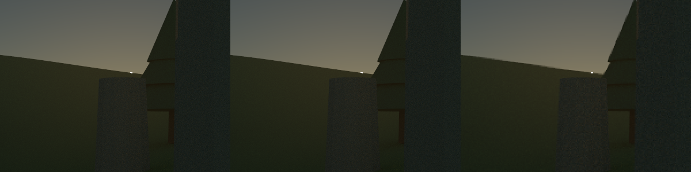

# Center-weighted GPU sampling experiment

October 28, 2026. Audience: players trying the optional game setting and maintainers evaluating
its quality, cost and lifecycle. This is fixed foveated rendering: sampling density depends on
distance from screen center, not measured eye position. It is off by default and has not received
human quality acceptance. The implementation is based on commit `984d5ac`; measured source
hashes are recorded in `source-hashes.json`.

## Try it

Launch the normal Swing GPU game with `./game.ps1 -Backend gpu`. Release the pointer with
Escape and select **Render → Center detail (experimental)**. Start with **1080p** and
**Fixed resolution**, and Full atmosphere, then toggle the option while looking at the same scene. The full-density
center should retain its detail while the edges become coarser. The HUD is drawn afterward
and remains sharp. Turning the option off restores uniform sampling.

Move and turn through the ruins, watch peripheral trees and thin silhouettes, then stop and
allow refinement. Inspect the changes in noise size between the density bands. Also change
resolution, save/revisit a capture, and toggle off again. There should be no holes, old scene
fragments or changes to previously captured images. If running windowed, try odd dimensions
and different aspect ratios. Human motion, distraction and live-window acceptance remain open.

The 60/120 FPS movement budgets remain available. They scale the whole internal grid, so the
center is full density relative to that grid, not necessarily the selected 1080p. Stopping
restores the selected grid, but peripheral footprints stay coarse until Center detail is off.
Stationary refinement reduces noise; it does not restore independent peripheral pixels.
The mode uses Full primary atmosphere/fog integration even if Half or Quarter is selected in
the Fog controls. Off restores the requested atmosphere setting. CPU rendering stays uniform;
the Center detail checkbox is disabled for that backend. Native GPU presentation is not promoted.

## Sampling and correctness

The image is divided into 8×8 tiles. At each tile center, normalized coordinates u and v run
from zero to one across the image. Elliptical radius is `sqrt((2u-1)^2 + (2v-1)^2)`.

| Radius | One primary path covers | Spatial density relative to uniform |
| --- | --- | --- |
| At most 0.5 | 1×1 pixel | Full |
| Above 0.5 through 0.85 | 2×2 pixels | One quarter |
| Above 0.85 | 4×4 pixels | One sixteenth |

The central ellipse is about 960×540 inside a 1920×1080 grid. Classification is quantized to
tiles; partial tiles and footprints are clipped at image edges. Each path samples its own
footprint, then its progressively averaged linear radiance is copied to the covered pixels.
Depth zero samples footprint centers; stochastic paths jitter within the footprint. At 1080p
this means 655,680 primary paths per pass versus 2,073,600 uniformly: 31.62%. This is not a
count of all shadow/continuation rays and does not predict an equivalent FPS multiplier.

The first trial intentionally has distinct density bands and block reconstruction. One-sample
noise changes size at those bands; they can be visible. There is no eye tracking, temporal
reconstruction, denoising or smooth transition filter. Peripheral detail loss can be noticed
when looking away from the crosshair. These are reasons to keep it optional, not claims that
the approximation is perceptually invisible.

`GpuFoveation` builds a compact list of ray locations on the GPU owner, outside the input
monitor, and reuses it until the internal grid changes. At 1080p the list is about 2.5 MiB.
It retains one grid's list; image/output storage and readback remain full-grid size. Mode changes
invalidate accumulation and reset adaptive cost estimates. Published images still obey the
existing lease protocol. Captures preserve the setting; old capture files default to off.
The CPU path ignores this GPU-only setting.

## Fixed-camera image comparison

`FoveatedPreview` renders a static ruins camera at depth 8 with clear atmosphere, no combat or
regional fog, and a fixed simulated time of about 06:24 (hour 6.396). These images are separate from
the moving combat performance route. Files include [one-sample foveation](foveated-1.png),
[64-sample foveation](foveated-64.png), [64-sample uniform](uniform-64.png), and
[uniform half-resolution enlarged](half-enlarged-64.png).

The center crop below is, from left to right: uniform 1080p, foveated 1080p, and uniform 960×540
enlarged to 1080p. Each uses 64 samples per rendered footprint. The 400×300 center crop has
encoded RGB root-mean-square error 0 for foveation and 2.961665 for the half-resolution image
against the uniform reference (channels range from 0 to 255). This confirms center preservation
for this view. It is not a whole-image quality score, an equal-time comparison, or a claim of
convergence to a noise-free ground truth. The center matches exactly because its rays and seeds
are preserved. Visual inspection confirms coarser peripheral silhouettes and larger noise blocks.



## Isolated dispatch cost

`FoveatedCost` uses the same static clear-atmosphere scene, packed readback and GPU snapshots,
with no Swing or moving combat. Each mode gets 30 warmup calls and 100 measured calls per round.
Every call restarts at sample zero. The order is uniform/sparse/compact, reversed in round 1.
Sparse dispatch is a benchmark reference that launches full-grid workgroups and skips unused
lanes; compact dispatch packs the same ray locations together. Tests compare their exact pixels.

| Round | Uniform / sparse / compact median GPU execution, ms | Uniform / sparse / compact median host trace, ms |
| --- | --- | --- |
| 0 | 10.693 / 8.188 / 3.983 | 12.586 / 10.198 / 5.837 |
| 1 | 11.157 / 8.610 / 3.985 | 12.922 / 10.636 / 6.182 |
| 2 | 11.331 / 8.453 / 4.010 | 13.096 / 10.593 / 6.097 |

The compact layout is retained because it materially improves the measured dispatch cost.
Median mapped-memory readback remains about 0.87–1.04 ms: reducing primary paths does not shrink
the full-size image. GPU time overlaps host waiting and must not be added to host trace time.
Raw results: [dispatch-cost.csv](dispatch-cost.csv). `-Dgpu.sparseFoveation=true` selects the
reference layout for benchmarks; it is not a player setting.

## Moving combat with real Swing painting

The final runs use the RTX 3080 12 GB, Windows and Java 23. `PresentationBenchmark foveated`
follows the same ten-second ruins camera route, combat at depth 8, Full atmosphere, a selected
1920×1080 grid, and a 3840×2160 offscreen Swing destination. Each run warms for at least two
seconds and waits for an initial image; the previous GPU owner closes before the next run.
Each group has three pairs in on/off, off/on, on/off order. No builds, checks or other agent
benchmarks ran concurrently. Other desktop activity was not controlled. Do not compare absolute
rates directly with reports from previous sessions.

| Fixed 1080p pair | Uniform / foveated fresh paints/s | Uniform / foveated p95 interval, ms | Uniform / foveated median host trace, ms |
| --- | --- | --- | --- |
| 0 | 45.7 / 66.2 | 33.662 / 28.755 | 14.378 / 7.430 |
| 1 | 46.2 / 73.2 | 34.740 / 26.034 | 14.502 / 7.049 |
| 2 | 45.3 / 71.4 | 33.783 / 26.100 | 14.508 / 7.289 |

The median rate across runs increases from 45.7 to 71.4 (about 56%), with identical center
sampling at the same grid. This trades peripheral detail for work reduction. The mode does
not meet a minimum 60 FPS: about 33–39% of measured intervals still exceed 16.67 ms.

| 120-budget pair | Uniform / foveated fresh paints/s | Uniform / foveated mean internal width | Uniform / foveated p95 interval, ms |
| --- | --- | --- | --- |
| 0 | 107.6 / 89.4 | 828.6 / 975.0 | 19.134 / 23.035 |
| 1 | 112.9 / 97.7 | 833.9 / 1128.3 | 18.096 / 21.377 |
| 2 | 114.5 / 105.0 | 848.7 / 1185.1 | 18.711 / 18.885 |

The adaptive mode chooses denser grids, hence more central spatial samples, but fresh-paint
throughput falls in every pair. This is not an equal-frame-time quality win. Full-grid readback
and painting still cost time, and the budget policy does not include the entire Swing paint
path. Keep uniform adaptive rendering as the default when smoothness is the priority. Further
work could account for presentation cost and smooth the density bands, after player feedback.

Raw summaries are [fixed-summary.csv](fixed-summary.csv) and [adaptive-summary.csv](adaptive-summary.csv).
The twelve `round-*-foveated-*.csv` files contain correlated fresh-paint timings; their field
semantics are documented in [the paint profiling report](../paint-clear/README.md#reading-the-correlated-timings).
They measure software paint completion, excluding native window submission, desktop composition,
monitor scanout and physical input latency. A p95 interval means 95% of measured intervals were
at or below it, not a guaranteed minimum FPS. This experiment does not assess the separate native
presentation option or establish an invisible quality reduction in motion.

## Verification and reproduction

`verify.ps1`, `gpu-check.ps1` and `game-check.ps1` passed; their logs are included here.
`FoveatedCheck` verifies exact central rays, every footprint pixel including partial tiles,
odd/thin grids and 1080p, progressive samples, finite aperture, Full fog fallback, compact/sparse
agreement, mode toggles, raw/packed equivalence, held images and close. `GameCaptureTest` checks
setting preservation through edits and capture roundtrips, plus old-file defaults. Existing
GPU checks continue to cover uniform reference behavior, native fallback and adaptive lifecycle.

From the repository root, build and compile the measurement tools:

```powershell
./gpu-build.ps1
$jdk = 'C:/Users/andri/.jdks/openjdk-23.0.1/bin'
$cp = 'out/gpu/classes;out/game/classes;out/gpu/lib/*'
& "$jdk/javac.exe" --enable-preview --release 23 -cp $cp -d out/gpu/classes tools/gpu/FoveatedCost.java tools/gpu/FoveatedPreview.java tools/gpu/PresentationBenchmark.java
& "$jdk/java.exe" --enable-preview '-Djava.awt.headless=true' -cp $cp gpu.FoveatedCost
& "$jdk/java.exe" --enable-preview '-Djava.awt.headless=true' -cp $cp gpu.FoveatedPreview
& "$jdk/java.exe" --enable-preview '-Djava.awt.headless=true' '-Dgame.benchmarkSeconds=10' '-Dgame.benchmarkBudget=0' '-Dgame.profileFrames=true' '-Dgame.profileDirectory=out/performance/foveated-fixed' -cp $cp game.PresentationBenchmark foveated
```

Repeat the final command with budget `120` and a different profile directory for adaptive pairs.
Run measurements sequentially without builds, checks or other benchmarks. Automated background
runs on Windows must use a console-free launcher. The existing unrelated fullscreen launcher
edits were preserved and are not part of this experiment.
