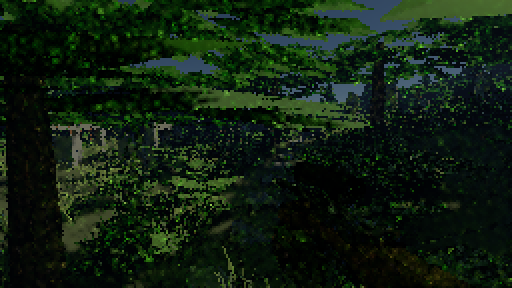
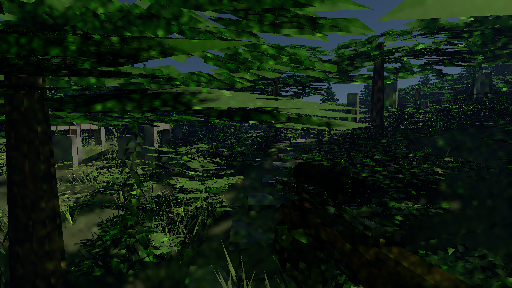
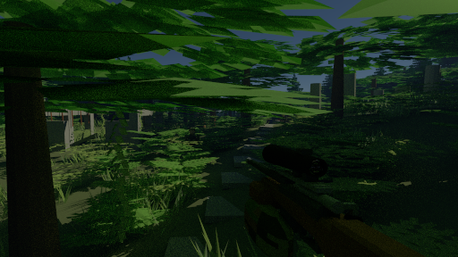

# Native visibility with reduced-resolution lighting

The sample game's GPU renderer can now trace diffuse lighting at half or two-thirds resolution while retaining the requested output resolution for surface visibility. This is the second reconstruction increment toward **120 real frames per second at 1920×1080 on an RTX 3080**. It delivers a useful intermediate tradeoff: the measured combat route reaches **55–56 fresh frames per second** with 960×540 lighting and 1920×1080 output, compared with **29–30** for raw native rendering. It does not reach 120 FPS.

## Try it

Run the GPU sample game, press **Esc**, open **Render**, and choose **Half** under **Lighting resolution (experimental)**. Set the game's resolution to **1920×1080**. The lighting selector enables temporal reconstruction, sets aperture to zero, disables Center detail, selects Full atmosphere quality, and sets **Movement frame budget** to **Fixed resolution**. That setting disables automatic resolution changes while moving; it does not cap FPS. The lighting split requires it so the output grid stays fixed while only the lighting grid is reduced. It retains path depth unless it was zero, in which case it raises it to one. **Two thirds** uses 1280×720 lighting at that output size; **Full** restores full-resolution lighting. Full is the default.

Changing to an adaptive frame budget, finite aperture, Center detail, reduced atmosphere quality, depth zero, or temporal reconstruction off suspends the lower lighting scale. The setting is remembered. The renderer uses its normal rendering path until those prerequisites are restored. Backend status reports the actual lighting and output grids, reconstruction time, and visibility time. The CPU renderer rejects a non-default lighting scale. Captures save the setting; older captures default to Full.

## Gameplay measurements

These results were recorded on 2026-10-29 using the RTX 3080 12 GB, driver 616.92, Java 23 and Vulkan. Apex Legends was closed before these runs; earlier runs made while it shared the GPU were discarded. No builds or other GPU checks ran alongside the reported timing runs.

`LightingRouteBenchmark` uses `AdventureWorld`, live enemy simulation, the first-person rifle, firing, camera translation and turns, and two seconds of scoped viewing. Every mode paints the game and heads-up display into an offscreen 1920×1080 Swing surface. It counts each fresh rendered publication once after painting. Each mode has a two-second warmup and a twelve-second measured route; two rounds reverse mode order. All modes use depth 8, one path sample per moving view, a pinhole camera, uniform sampling, Full atmosphere and bloom off. Adaptive resolution is disabled.

| Mode | Lighting grid | Visibility grid | Fresh FPS, two rounds | 95th-percentile fresh interval | 95th-percentile image age |
|---|---|---|---:|---:|---:|
| Raw native | 1920×1080 | 1920×1080 | 29.67 / 28.58 | 36.54 / 38.65 ms | 39.56 / 41.35 ms |
| Native temporal filter | 1920×1080 | 1920×1080 | 25.92 / 26.33 | 47.50 / 47.02 ms | 50.98 / 49.21 ms |
| Half-grid temporal, enlarged | 960×540 | 960×540 | 88.17 / 92.17 | 13.54 / 13.28 ms | 15.56 / 15.20 ms |
| New split, half lighting | 960×540 | 1920×1080 | 54.58 / 56.25 | 25.33 / 24.10 ms | 27.96 / 26.28 ms |
| New split, two-thirds lighting | 1280×720 | 1920×1080 | 39.67 / 41.42 | 31.98 / 33.42 ms | 34.14 / 35.48 ms |

The half-lighting split improves average fresh throughput by about **90%** over raw native rendering in this route. Enlarging a half-grid image remains faster, but loses surface detail. The target requires an 8.33 ms frame interval, including simulation and presentation; even the fastest tested mode falls short here.

Image age is elapsed time from the render snapshot to completed offscreen painting. Intervals include a final unfinished hold. These are software fresh-frame measurements, not monitor scanout, physical input latency, native swapchain presentation, or generated frames. The route uses elapsed time, so the simulation states sampled by modes with different frame rates are not identical. Use the separate frozen-state quality test below for image comparisons. [Round summaries](route.log), [per-frame rows and settings](route/) retain the measurements. The split-mode settings logs predate a telemetry-only correction: their `fog reused` counter counted native lighting reuse; the delivered code correctly reports zero for that separate fog-pass counter. This does not affect pixels or timings.

## Quality and remaining limitations

`LightingQualityScene` constructs twelve deterministic combat states at 512×288, including moving enemies, a shot, camera motion, and rifle-to-scope transitions. Each mode renders the exact same world and camera states at one sample. Separate 128-sample native images provide references. This test compares image quality, not equal rendering time or 1080p aiming accuracy.

| Mode | Mean display-space squared error |
|---|---:|
| Raw native, one sample | 0.00358745 |
| Native temporal filter | 0.00203710 |
| Half-grid temporal filter, nearest enlargement | 0.00302292 |
| New split, half lighting | 0.00210253 |

The split reduces error by **30.45%** relative to enlarged half-grid filtering and has **3.21%** more error than full-grid filtering. Error is the mean squared RGB difference after the approximate display mapping `(max(x,0)/(1+max(x,0)))^(1/2.2)`. It does not measure ghosting or target recognition. [Per-state results](quality.csv) and [summary](quality.log) are saved.

| Enlarged half-grid, state 7 | Native visibility, half lighting | 128-sample reference |
|---|---|---|
|  |  |  |

The split restores fine foliage and rifle outlines, but noisy lighting remains. Visibility uses native pixel centers, so thin edges can alias and shimmer; this is not temporal antialiasing. Lighting and atmospheric interpolation can blur small shadows or introduce bias near boundaries. Directional foliage retains radiance filtering rather than ordinary diffuse color separation.

Glass uses complete native paths rather than reconstructed lighting. The [one-sample scoped image](split-11.png) remains much noisier than its [128-sample reference](reference-11.png), and scope readability remains unresolved during motion. This is a known limitation of this opt-in increment, not a successful scope reconstruction result. Lighting history still has the earlier filter's restrictions, including no reuse across grid changes and repeated camera-keyed noise for stationary cameras with moving objects. Human testing of fast turns, sustained motion and target readability is still needed.

## Implementation and cost

`RenderSettings.lightingScale` separates the lighting grid from the presentation grid. `GpuRenderSession` owns both captured views, separate raw and presented snapshots, and immutable dimensions for detached packed pixels and resident copies. Raw means and sample counts describe the lighting grid only. Mode and grid changes invalidate presentation history; retained leases remain readable through edits and shutdown.

The low-grid trace records the existing primary hit and surface color, then runs the existing diffuse spatial/temporal filter. A native pixel-center ray determines the visible surface for every output pixel. The reconstruction pass gathers illumination only from matching object identities, normals, surface planes and nearby hit positions, then applies the native surface color. Sky misses gather atmospheric light and transmission only from other misses; the visible sun disc is evaluated at the native ray direction.

Glass, near-black colors that cannot be safely separated from lighting, and surfaces without compatible lighting samples enter a compact GPU queue. A second, indirect dispatch traces complete paths only for those pixels. Keeping this work out of the common visibility pass avoids making entire groups of pixels wait for scattered expensive paths. The queue is bounded by the output pixel count and supports multiple dispatch rows for large outputs. Fallback means refine separately and clear when raw accumulation restarts. No GPU-to-CPU readback is needed to dispatch the queue.

`LightingCostBenchmark` isolates GPU work in the atmospheric forest without combat or painting. It uses ten warmup and thirty measured views per mode with a tiny camera translation. In this diagnostic, half lighting took **11.58 ms**, including **0.45 ms** filtering and **2.84 ms** native visibility plus fallback tracing; native filtered rendering took **39.56 ms**. At half lighting, 92.48% of native pixels reused surface lighting, 3.50% reused sky atmosphere and 4.02% traced fallback paths. These are single-order diagnostic medians, not the gameplay results or a precision speedup claim. They exclude packed display encoding, publication readback, game simulation and painting. [GPU cost log](gpu-cost.log) records all modes. The measured game route's peak device allocation was approximately 345 MiB for the half-lighting split.

## Verification and next work

The implementation is deliberately opt-in. `LightingReconstructionCheck` verifies unchanged raw lighting estimates through progressive samples, odd dimensions, native thin silhouettes, empty and full fallback queues, dispatches exceeding 65535 workgroups, packed/exposure equivalence, captured display dimensions, adaptive and lens fallbacks, mode changes, resident copies, leases and shutdown. `GpuUiCheck` exercises the real lighting selector and native-size game conversion. Capture tests cover new settings and older files. The [GPU](gpu-check.log), [game](game-check.log) and [repository completion](verify.log) gates passed. The [dedicated lighting checks](lighting-check.log) also passed; the existing readability baseline was not expanded.

This increment completes the gameplay baseline and the first separate visibility/lighting path. NVIDIA Real-Time Denoisers (NRD) and temporal upscaling remain subsequent integrations. A local pinned NRD 4.18.0 SDK build and scheduling-bridge experiment were prepared, but no NRD code, runtime dependency or denoiser is included in this change. NRD needs fresh radiance/hit-distance signals, normal/depth textures and consistent camera/object motion conventions; the [official integration guide](https://github.com/NVIDIA-RTX/NRD#integration) defines those contracts. Scope glass also needs a reconstruction strategy beyond the diffuse-only filter. The next candidate should be compared against both the enlarged half-grid and native-visibility split, and advance only when total frame time and motion readability improve together.

## Reproduce

From the repository root in PowerShell, with other GPU applications closed:

```powershell
./gpu-build.ps1
$jdk = "$env:USERPROFILE/.jdks/openjdk-23.0.1/bin"
$cp = 'out/gpu/classes;out/game/classes;out/gpu/lib/*'
& "$jdk/javac.exe" --enable-preview --release 23 -cp $cp -d out/gpu/classes tools/gpu/ReconstructionBenchmark.java tools/gpu/LightingRouteBenchmark.java tools/gpu/LightingCostBenchmark.java tools/gpu/LightingQualityScene.java tools/gpu/LightingQualityBenchmark.java
& "$jdk/java.exe" --enable-preview '-Djava.awt.headless=true' -cp $cp game.LightingRouteBenchmark out/lighting/replay raw1080,temporal1080,temporal540,split540,split720
& "$jdk/java.exe" --enable-preview '-Djava.awt.headless=true' -cp $cp gpu.LightingCostBenchmark
& "$jdk/java.exe" --enable-preview '-Djava.awt.headless=true' -cp $cp gpu.LightingQualityBenchmark out/lighting/replay-quality
./gpu-check.ps1
./game-check.ps1
./verify.ps1
```

The benchmarks create no visible game window. Run them sequentially. [Source hashes](sources.json) identify the delivered code and benchmark tools. The earlier same-grid implementation and its measurements remain documented in the [first reconstruction report](../temporal/README.md).
