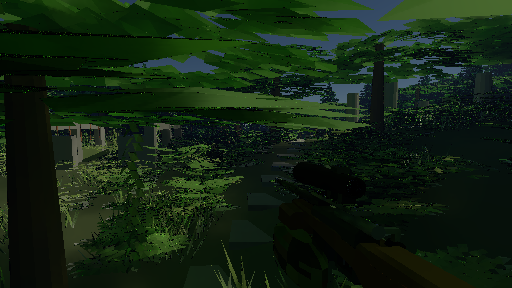

# Optional NRD diffuse denoising

The sample game's Vulkan renderer now supports **NVIDIA Real-Time Denoisers (NRD) 4.18.0**, using its RELAX diffuse filter. NRD consumes fresh path samples, surface guides and camera/object motion. It can filter either the full image or the smaller lighting grid used by the separate native-visibility mode. The built-in filter remains the default.

The fixed-state combat comparison shows lower image error than the corresponding built-in modes: **42.7% lower at full resolution** and **17.4% lower with half-resolution lighting and native visibility**. In the clean gameplay timing runs, NRD reaches **25.83 fresh FPS at native 1080p** and **54–55 FPS with half-resolution lighting and native visibility**, about 3% and 6% less throughput than the corresponding built-in filters. Scope glass remains noisy. NRD provides an optional quality tradeoff; this change does **not** establish 120 FPS at 1920×1080.

## Install and try

From the repository root, run `./setup-nrd.ps1` once, then `./gpu-build.ps1`. Setup requires Git, CMake 3.30 or newer, and Visual Studio C++ build tools with a Windows SDK. The renderer requires Java 23. The first setup needs network access; `./setup-nrd.ps1 -Offline` verifies the cached runtime without downloading anything. Close an existing NRD game session before rebuilding its loaded DLLs.

Launch the GPU sample game, press **Esc**, open **Render**, and choose **NRD RELAX (experimental)** under **Denoiser**. This selection enables temporal reconstruction, sets aperture to zero, selects uniform sampling and Full atmosphere quality, and raises depth to one if it was zero. The physical scope still requires depth eight. Select **Built-in diffuse** to compare with the previous filter, or turn **Temporal reconstruction** off to show raw output.

For native 1080p visibility with cheaper lighting, set output resolution to **1920×1080** and choose **Half** under **Lighting resolution (experimental)**. Lighting then uses 960×540 pixels. Half also selects **Movement frame budget → Fixed resolution**, which disables resolution adaptation while moving; it does not cap FPS. Choosing NRD alone preserves the current resolution and movement-budget settings.

The NRD selector is disabled when its runtime is absent. Programmatic configuration rejects an unavailable runtime before changing the running game's settings. The CPU backend rejects NRD. Captures retain the denoiser selection; older captures select the built-in filter. Loading a capture that requests NRD requires the runtime.

## Quality comparison

Results were recorded on 2026-10-29 with an RTX 3080 12 GB, driver 616.92, Java 23 and Vulkan on Windows. `NrdQualityBenchmark` renders twelve frozen combat states from `LightingQualityScene` at 512×288. The states contain camera motion, moving enemies, a shot and rifle-to-scope transitions. All modes receive identical world/camera states. Each mode is warmed before the sequence. Separate 128-sample native renders provide references. The score is mean squared RGB error after the display approximation `(max(x,0)/(1+max(x,0)))^(1/2.2)`.

| Mode | Mean display-space squared error |
|---|---:|
| Raw native, one sample | 0.00358745 |
| Built-in filter, native | 0.00203710 |
| Built-in filter, half grid enlarged | 0.00302292 |
| Built-in filter, half lighting with native visibility | 0.00210253 |
| NRD, native | 0.00116724 |
| NRD, half grid enlarged | 0.00187125 |
| NRD, half lighting with native visibility | 0.00173652 |

NRD's enlarged half-grid image has lower aggregate error than the built-in native image in this test, but its outlines still have half-grid detail. The score does not measure target recognition, ghost trails, temporal stability or 1080p aiming accuracy. The modes are not compared at equal rendering time. [Per-state errors](quality.csv) and [summary](quality.log) retain the results.

| Built-in, half lighting/native visibility | NRD, half lighting/native visibility | Native 128-sample reference |
|---|---|---|
|  |  |  |

The [full-resolution NRD image](nrd-7.png) can also be compared with the [full-resolution built-in image](temporal-7.png). Floor and weapon lighting are cleaner with NRD. Fine foliage still contains uncovered pixels and aliasing. The [scoped NRD split image](nrdsplit-11.png) remains much noisier than its [reference](reference-11.png): glass is outside this diffuse integration.

NRD mode currently traces primary rays through pixel centers so each fresh lighting sample matches its depth and normal guides. The built-in mode uses per-pixel primary jitter. These scores therefore compare complete rendering modes, including their sampling differences, rather than isolating the denoiser algorithm. Pixel-center visibility has no temporal antialiasing and can shimmer during motion. Human evaluation of fast turns and sustained target tracking is still required.

## Gameplay performance

The clean timing comparison was recorded on 2026-10-29 with Apex Legends closed and no builds or other GPU verification jobs running. Earlier partial timings collected while Apex shared the GPU were discarded. The GPU, driver and runtime match the quality-test environment above.

`LightingRouteBenchmark` runs live enemy simulation, the first-person rifle, firing, camera translation and turns, and two seconds of scoped viewing. All modes use depth 8, one path sample per moving view, a pinhole camera, uniform sampling, Full atmosphere and bloom off. Adaptive resolution is disabled. Each mode has a two-second warmup and a twelve-second measured route; the second round reverses mode order. Each fresh publication is counted once after painting the game and heads-up display into an offscreen 1920×1080 Swing surface.

| Mode | Lighting grid | Visibility grid | Fresh FPS, two rounds | 95th-percentile fresh interval | 95th-percentile image age |
|---|---|---|---:|---:|---:|
| Raw native | 1920×1080 | 1920×1080 | 29.83 / 30.08 | 36.27 / 35.75 ms | 39.66 / 38.52 ms |
| Built-in filter, native | 1920×1080 | 1920×1080 | 26.67 / 26.42 | 40.27 / 45.51 ms | 42.53 / 47.63 ms |
| NRD, native | 1920×1080 | 1920×1080 | 25.83 / 25.83 | 41.40 / 47.78 ms | 43.73 / 50.53 ms |
| Built-in filter, half grid enlarged | 960×540 | 960×540 | 87.75 / 91.67 | 13.44 / 13.29 ms | 15.38 / 15.46 ms |
| NRD, half grid enlarged | 960×540 | 960×540 | 86.92 / 85.08 | 14.05 / 15.26 ms | 15.86 / 17.89 ms |
| Built-in filter, half lighting/native visibility | 960×540 | 1920×1080 | 58.00 / 58.08 | 24.05 / 24.23 ms | 26.09 / 26.15 ms |
| NRD, half lighting/native visibility | 960×540 | 1920×1080 | 54.42 / 54.83 | 25.14 / 24.80 ms | 27.29 / 27.01 ms |

Across the two rounds, NRD has approximately 3% less fresh throughput at native resolution, 4% less with an enlarged half grid and 6% less with half lighting/native visibility than the corresponding built-in modes. These are averages of two short runs, not precision estimates. The quality test shows lower image error, but NRD does not improve throughput in this route. Even enlarging the entire half-grid image falls short of the 120 FPS target, which requires an 8.33 ms frame interval. The built-in filter remains the default.

Image age runs from snapshot capture to completed offscreen painting. Fresh intervals include a final unfinished hold. Total throughput includes simulation, renderer preparation, NRD conversion/filtering, publication/readback and offscreen painting. It excludes physical input, monitor scanout and native swapchain presentation, and uses no generated frames. Because the route follows elapsed time, modes with different frame rates sample different simulation states; use the frozen-state quality test for image comparisons. [Round summaries](route.log) retain median and tail timings; [per-frame rows and settings](route/) retain the underlying measurements. The earlier [native-visibility report](../lighting/README.md) remains a separate historical baseline.

## Implementation and limits

The optional C++ bridge in `tools/nrd/bridge.cpp` exposes NRD's pipeline descriptions and per-frame dispatch schedule. Java owns Vulkan textures, pipelines, descriptors and synchronization; the bridge does not own graphics handles. `setup-nrd.ps1` pins upstream commit `e06852bd545973cb224eb28820b891205cfc1624`, builds embedded SPIR-V shaders, and stores the DLLs, license and a checksum manifest under `out/nrd/runtime/Release`. Normal encoding is NRD's packed 10-bit format, roughness encoding is linear, and quad intrinsics are disabled. The [upstream integration guide](https://github.com/NVIDIA-RTX/NRD/tree/e06852bd545973cb224eb28820b891205cfc1624#integration) describes NRD's signal conventions.

The trace shader writes fresh RGB radiance and first-secondary-hit distance separately from progressive means. The conversion pass removes primary atmospheric light and surface color before filtering, then restores the current color and primary atmospheric light afterward. Directional leaves retain radiance filtering with unit color separation. Unsupported pixels, including sky, glass, near-black colors and surfaces beyond the denoising range, keep raw output. The separate native-visibility pass retains its existing complete-path fallback.

Guides use world-space normals, positive axial view depth and previous-minus-current world-space object motion. Camera motion comes from current/previous column-major matrices. Conversion flips the tracer's bottom-up rows into NRD's top-down textures. The implementation rejects skewed sensor axes for NRD and restores raw presentation for finite aperture, nonuniform sampling, reduced atmosphere quality or depth zero.

NRD histories are separate from raw means and the built-in filter's histories. Repeated sample zero of an identical snapshot resets history instead of counting the same estimate twice. Progressive samples and changed views can accumulate history. Scene revision and instance transforms decorrelate transport noise during animation; identical captured inputs reproduce raw samples independently of job/visit order. Restarts, incompatible settings, grid changes, camera cuts and stale intervals reset history. Switching denoisers invalidates old presentation immediately. Detached and resident images remain owned by their leases through subsequent rendering and shutdown.

RELAX uses up to sixteen diffuse history frames, four fast-history frames and four spatial-filter iterations. This remains an opt-in diffuse implementation. It does not include a specular/glass denoiser, temporal upscaler, frame generation or a new default quality preset.

## Verification and reproduction

The [GPU suite](gpu-check.log), [game suite](game-check.log) and [repository completion gate](verify.log) passed. Final [NRD checks](nrd-check.log) cover matrix projection, fresh-sample accumulation, captured-input reproducibility, moving-object vectors, texture orientation, restart/resize behavior, unsupported settings, sky and distant-surface fallbacks, native display dimensions, packed/resident equivalence and lease lifetime. The [game control checks](ui-check.log) also cover runtime unavailability and atomic rejection. [Runtime construction](setup-build.log) and [offline verification](setup-offline.log) passed. The readability baseline was not expanded.

For a clean comparison, close other GPU games and run the following sequentially from the repository root:

```powershell
./setup-nrd.ps1 -Offline
./gpu-build.ps1
$jdk = "$env:USERPROFILE/.jdks/openjdk-23.0.1/bin"
$cp = 'out/gpu/classes;out/game/classes;out/gpu/lib/*'
& "$jdk/javac.exe" --enable-preview --release 23 -cp $cp -d out/gpu/classes tools/gpu/ReconstructionBenchmark.java tools/gpu/LightingQualityScene.java tools/gpu/NrdQualityBenchmark.java tools/gpu/LightingRouteBenchmark.java
& "$jdk/java.exe" --enable-preview --enable-native-access=ALL-UNNAMED '-Djava.awt.headless=true' -cp $cp gpu.NrdQualityBenchmark out/nrd/replay-quality
& "$jdk/java.exe" --enable-preview --enable-native-access=ALL-UNNAMED '-Djava.awt.headless=true' -cp $cp game.LightingRouteBenchmark out/nrd/replay-route raw1080,temporal1080,temporal540,split540,nrd1080,nrd540,nrdsplit540
./gpu-check.ps1
./game-check.ps1
./verify.ps1
```

[Source hashes](sources.json) identify the unchanged implementation and benchmark tools used for both the quality and clean timing runs. NRD earns an optional place through lower measured image error at modest additional cost. The next performance work must reduce total rendering cost while preserving motion readability; temporal upscaling and scope reconstruction remain further work. Human testing of fast turns and target tracking is still outstanding.
