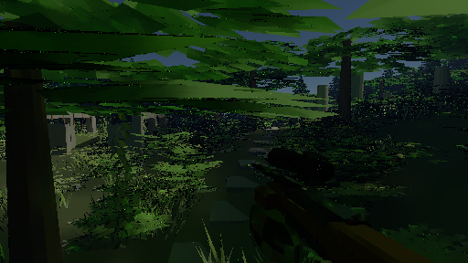

# Optional GPU path roulette

The sample game's GPU renderer now supports **Path roulette**, an optional way to stop low-contribution lighting paths early. A random subset continues with increased weight, preserving the raw estimator's expected brightness at the selected maximum depth. The saved work comes with additional noise. The option defaults off and the existing reference path remains available.

On the RTX 3080, the final fixed-view comparison reduces GPU time by **43% at 960×540** and **36% with 960×540 lighting plus 1920×1080 visibility**. With NRD filtering, the frozen combat quality test shows **4.6–9.4% more image error** at one sample per state. The gameplay results below measure the complete offscreen delivery path separately; shader timings are not FPS claims.

## Try it

Launch the GPU sample game, press **Esc**, open **Render**, and enable **Path roulette (experimental)**. The option changes path termination only. It retains the selected resolution, maximum depth, atmosphere, denoiser, movement budget and camera optics. It works with raw output and either denoiser; NRD is useful for smoothing the additional noise. Selecting roulette does not install or enable NRD.

For the native-visibility comparison, select **1920×1080**, **Denoiser → NRD RELAX**, and **Lighting resolution → Half**. Half lighting sets Movement frame budget to Fixed resolution, keeping 1080p output and visibility while lighting uses 960×540. Turn roulette off to compare the same settings. To reproduce the enlarged half-grid comparison instead, select **960×540**, Full lighting resolution and a fixed movement budget; its 1080p painted image has lower-resolution visibility.

The CPU backend rejects roulette, and its checkbox is disabled there. Captures retain the setting; older captures default it off. Changing roulette restarts raw accumulation and reconstruction history. Held images remain valid across the change. The backend status includes `path roulette true` or `false`.

## Why path termination came before atmosphere caching

The first experiment used diagnostic shader variants that deliberately removed work. `TransportCostBenchmark` renders the frozen rifle and scope states 7 and 11 from `LightingQualityScene`, with a small repeatable camera translation, depth 8 and NRD. Each variant receives twenty warmup frames and forty measured frames at each grid. Two rounds reverse variant order. The table averages the four GPU-time medians for each configuration: two states times two rounds.

| Diagnostic shader | 960×540 image | Half lighting, native 1080p visibility |
|---|---:|---:|
| Original transport | 7.50 ms | 10.75 ms |
| Remove atmospheric segment integration | 6.02 ms | 8.99 ms |
| Keep atmospheric integration only on primary segments | 5.66 ms | 8.41 ms |
| Stop after two diffuse surface interactions | 2.08 ms | 4.12 ms |
| Stop after one diffuse surface interaction | 1.29 ms | 3.14 ms |

The atmosphere variants retain the existing surface sun/sky lighting setup. The diffuse caps keep the original glass-boundary handling and maximum total depth, but omit later diffuse light. These are diagnostic images, not shipped quality presets. Removing work also changes shader optimization and scheduling, so the differences are not additive component timings; the primary-only result being faster than removing all atmospheric integration illustrates that limit. [Ablation summaries](ablation.log) and [individual frames](ablation-frames.csv) retain the evidence.

Later diffuse continuation was the larger opportunity, so this increment tests probabilistic termination instead of shipping a fixed diffuse cap or rewriting atmosphere. The 32-step atmospheric integration remains unchanged. The original shader for these ablations is the committed `assets/gpu/diffuse.comp` at `c6e702f`; the benchmark can compile it into a separate output directory without replacing the game's shader.

## Final GPU cost and image quality

The final production shader was compared with roulette off/on using the same fixed-view method. GPU timestamps include tracing, NRD, native visibility/fallback when enabled, and packed display encoding. They exclude game simulation, offscreen painting and monitor presentation; host preparation and readback are recorded separately in the raw rows.

| Configuration | Roulette off | Roulette on | GPU-time reduction |
|---|---:|---:|---:|
| NRD, 960×540 image | 7.51 ms | 4.29 ms | 42.9% |
| NRD, 960×540 lighting / 1920×1080 visibility | 10.85 ms | 6.91 ms | 36.3% |

[GPU summaries](gpu-cost.log) and [individual frames](gpu-cost-frames.csv) retain both rounds. The production off-mode shader exactly matches the pre-change shader's progressive pixels in the dedicated room/glass checks.

`TransportQualityBenchmark` compares twelve identical frozen combat states at 512×288 against separate 128-sample reference renders. The states include moving enemies, a shot and rifle-to-scope transitions. Each mode is warmed before history collection. NRD uses one fresh path per state; half-grid modes use 256×144 lighting. Error is mean squared RGB difference after the approximate display mapping `(max(x,0)/(1+max(x,0)))^(1/2.2)`.

| NRD configuration | Roulette-off error | Roulette-on error | Increase |
|---|---:|---:|---:|
| Native image | 0.00116724 | 0.00124110 | 6.3% |
| Half-grid image enlarged | 0.00187125 | 0.00195649 | 4.6% |
| Half lighting with native visibility | 0.00173652 | 0.00190057 | 9.4% |

These comparisons hold sample count and captured states fixed, not elapsed rendering time. They establish a noise/cost tradeoff, not improved equal-time quality or a human readability verdict. [Per-state errors](quality.csv) and [summary](quality.log) retain the measurements. The earlier [NRD report](../nrd/README.md) supplies the built-in-filter comparison.

| Roulette off, half lighting/native visibility | Roulette on | 128-sample reference |
|---|---|---|
|  |  |  |

Foliage aliasing and one-sample noise remain visible. The [scoped roulette image](roulette-split-11.png) should be compared with [roulette off](reference-split-11.png) and the [reference](reference128-11.png). Glass boundary crossings do not trigger roulette, but diffuse light reached through glass can still use it. This does not denoise glass, add temporal antialiasing or resolve motion readability.

## Gameplay comparison

`LightingRouteBenchmark` uses live enemies, movement, turns, firing and a two-second scoped segment. Every mode keeps depth 8, one fresh path sample, a pinhole camera, uniform sampling, Full atmosphere and bloom off. Adaptive resolution is disabled. Each mode receives two seconds of warmup and twelve measured seconds, followed by a second round in reverse mode order. Tests ran on an RTX 3080 12 GB with driver 616.92 and Java 23 on Windows on October 30, 2026. Apex was closed, and no build or test suite ran alongside the timing runs.

The table averages the two rounds of the final eight-mode run. Each fresh publication is counted once after a complete offscreen 1920×1080 Swing paint, including the game heads-up display. These are rendered frames, with no frame generation.

| Configuration | Roulette off | Roulette on | Throughput gain |
|---|---:|---:|---:|
| NRD, native 1920×1080 image | 23.9 FPS | 34.3 FPS | 43% |
| NRD, 960×540 image enlarged to 1080p | 63.8 FPS | 92.7 FPS | 45% |
| NRD, half lighting / native 1080p visibility | 37.6 FPS | 56.0 FPS | 49% |
| Built-in filter, half lighting / native 1080p visibility | 39.5 FPS | 57.1 FPS | 44% |

This does **not** reach the 120 real FPS target. The half-grid NRD roulette runs have 21.3–22.4 ms p95 fresh intervals despite median intervals near 7.9 ms. Native visibility retains finer geometry but remains more expensive. [Round summaries](route.log) contain median and tail intervals and image age; [per-frame rows and captured settings](route/) preserve the measurements. Physical input, monitor scanout and native swapchain presentation are excluded. Because the route follows elapsed time, different frame rates sample different simulation states; frozen-state results above provide the controlled image comparison.

Frame delivery was slower than in the earlier NRD session, even with roulette off: half-grid NRD previously delivered 85–87 FPS, versus 63–64 here, while median host tracing remained about 10 ms. Do not combine the historical baseline with this increment's results. A separate paired repeat with [correlated timing rows](route-profile/) reproduced the improvement and lower baseline: 60–63 → 87–90 FPS at half grid, and 37–39 → 56–57 with native visibility. [Repeat summaries](route-profile.log) retain both rounds. Extra instrumentation may affect timings, so these repeats are diagnostic rather than replacements for the main table.

In those repeats, median painting took 2.0–2.7 ms and median repaint-queue delay stayed below 1.7 ms. The delay from GPU-session completion to game-thread image pickup reached 12.6–15.3 ms at p95; native-visibility NRD without roulette had about 8 ms median pickup delay. GPU trace savings alone therefore do not describe the remaining frame-delivery bottleneck. The exact cause of the difference from the historical session is unresolved; diagnosing publication and scheduling stalls is the next performance task.

## Implementation and verification

After the second diffuse surface interaction, the shader derives survival probability from the largest RGB throughput channel, corrected for the temporary radiance scaling at glass transitions. Probability is clamped to 0.05–1. Surviving paths divide their future throughput by that probability; already-collected light is unchanged. Glass crossings do not increment the diffuse counter. Maximum depth still counts all continuations as before. The two-interaction minimum is fixed in this increment.

Roulette draws use a separate deterministic hash domain keyed by the existing captured path seed and continuation depth. They do not advance the material/light random stream. The mode therefore reproduces captured raw samples independently of visit order. This is standard [Russian roulette weighting](https://www.pbr-book.org/4ed/Light_Transport_I_Surface_Reflection/A_Better_Path_Tracer); preservation of expected raw radiance does not make an individual noisy image identical, nor remove denoiser bias.

`RenderSettings.pathRoulette` is part of the GPU accumulation and history keys. Configuration-copy methods preserve it, and capture deserialization supplies `false` for older files. A reserved parameter component carries the flag to all tracing variants, including native fallback paths. No extra image history or per-path buffer is allocated. A package-local `GpuKernel` constructor allows isolated diagnostic shader files; game rendering still loads its normal compiled shader.

The [dedicated checks](roulette-check.log) compare reference pixels with the pre-change shader, exact depth-zero/one behavior, pure-glass crossings, deterministic replay, configuration copies, CPU rejection, both denoiser histories and leased images through rapid off/on changes. Raw expected brightness is checked over eight seeds at 256 samples per pixel in a diffuse room and with a camera inside clear glass. Each RGB mean difference must fit six estimated standard errors plus 0.2% of reference brightness. These statistical checks supplement the weighting derivation; they do not establish support for rough, absorbing, nested or volumetric transport outside the GPU backend's existing contract.

The [full GPU suite](gpu-check.log), [game suite](game-check.log) and [repository completion gate](verify.log) passed. The GPU suite exercises the live game checkbox, while capture checks cover new and older files. The style baseline remains at 1976 existing finding groups. Native pointer/window behavior and human fast-turn/target-tracking assessment remain manual.

## Reproduce

Use Java 23, the optional NRD runtime from `./setup-nrd.ps1`, and the repository root as the working directory. Close other GPU games. Run verification and measurements sequentially; the benchmark creates no visible game window.

```powershell
./gpu-check.ps1
./game-check.ps1
./verify.ps1
$jdk = "$env:USERPROFILE/.jdks/openjdk-23.0.1/bin"
$cp = 'out/gpu/classes;out/game/classes;out/gpu/lib/*'
& "$jdk/javac.exe" --enable-preview --release 23 -cp $cp -d out/gpu/classes tools/gpu/CompileShader.java tools/gpu/ReconstructionBenchmark.java tools/gpu/LightingQualityScene.java tools/gpu/TransportCostBenchmark.java tools/gpu/TransportQualityBenchmark.java tools/gpu/LightingRouteBenchmark.java
& "$jdk/java.exe" --enable-preview --enable-native-access=ALL-UNNAMED '-Djava.awt.headless=true' -cp $cp gpu.TransportCostBenchmark out/transport/replay-cost assets/gpu/diffuse.comp reference,roulette-2
& "$jdk/java.exe" --enable-preview --enable-native-access=ALL-UNNAMED '-Djava.awt.headless=true' -cp $cp gpu.TransportQualityBenchmark out/transport/replay-quality out/gpu/diffuse.spv out/gpu/diffuse.spv production
& "$jdk/java.exe" --enable-preview --enable-native-access=ALL-UNNAMED '-Djava.awt.headless=true' -cp $cp game.LightingRouteBenchmark out/transport/replay-route nrd1080,roulette-nrd1080,nrd540,roulette-nrd540,nrdsplit540,roulette-nrdsplit540,split540,roulette-split540
```

Omit the final variant list from `TransportCostBenchmark` to run all current diagnostic variants. For the original ablation, export `c6e702f:assets/gpu/diffuse.comp` with Git into a local file and supply that file as the second argument. [Source hashes](sources.json) identify the delivered code and tools. The selected maximum depth, atmospheric model and default transport remain unchanged; further atmosphere caching and temporal upscaling are separate work.
