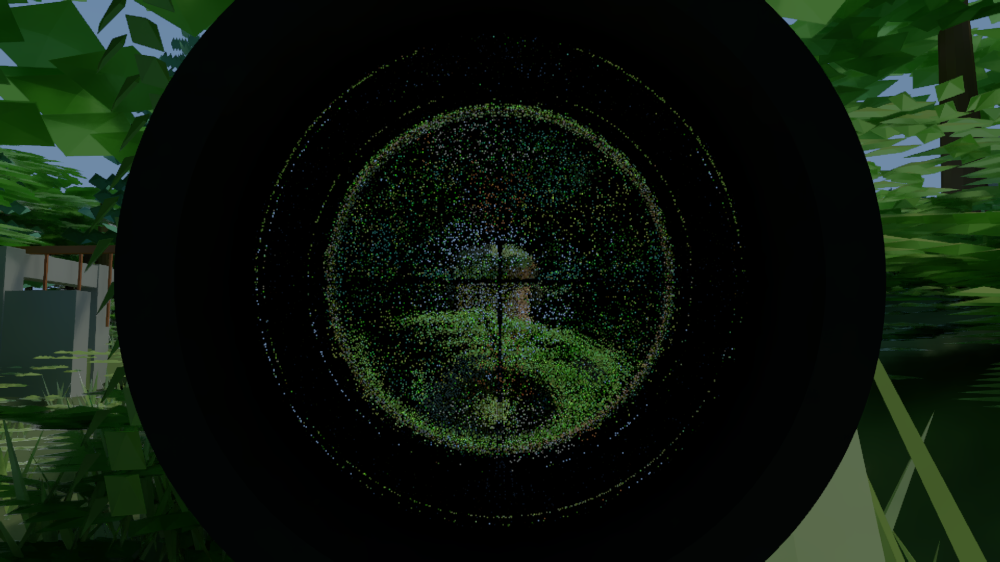
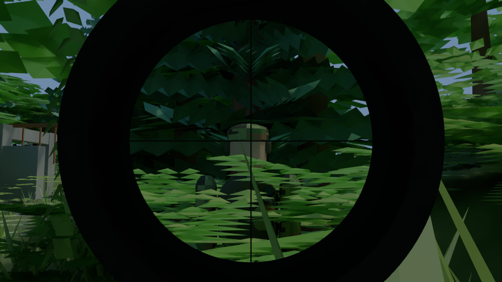
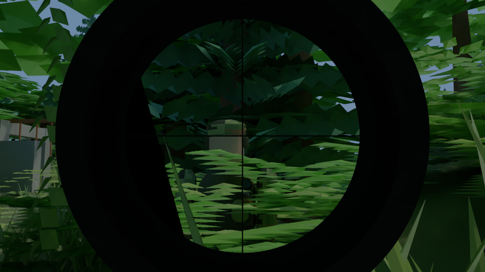

# Gameplay scope and reconstruction

The sample game replaces its three physical glass lenses with a fixed 4× gameplay optic.
The player selected a clean, responsive scope over physical lens simulation. The housing,
reticle, aim animation and geometric eye box remain. Here, the eye box means the range of
camera positions from which the entrance is visible through the housing. The clear circular
opening is wider than the usable image in the old lens assembly. The focus wheel is removed;
the ideal optic has no optical defocus. Existing 1.5× camera framing while aiming remains,
and the scope applies its additional 4× magnification only inside its entrance.

The original three lenses used about 196,608 triangles in total: 128 angular sectors and
128 radial rings per lens. Rays could encounter six stochastic Fresnel reflection/refraction
decisions before reaching the scene. Flat triangle normals refracted adjacent sectors and
rings differently. The saved capture still exhibited radial streaks and concentric distortion
at 64 raw samples per pixel, so additional sampling alone did not remove the pattern. NRD
excluded the glass, while FSR's reactive mask restricted reuse there.

The new optical entrance is a flat 128-triangle disk with one consistent normal. It redirects
the camera ray deterministically and does not consume a path-depth continuation. This removes
the faceted refraction and random glass branches. Diffuse lighting still uses path sampling;
NRD can now denoise that lighting through the optic. This changes the optical model, rather
than establishing physical equivalence to the old lenses. Combat no longer forces depth 8,
although its default depth remains unchanged.

## Capture comparison

The source is the local diagnostic capture
`out/game/captures/2026-10-30T21-56-39.344019300Z-4ef9e638-26c6-4554-a94b-e29fcd36e213`.
It is not included in Git. `ScopeCaptureScene` loads its displayed camera and lighting, then
updates `player/rifle/scope/*` and the rifle body at the saved housing transform. The body
change lowers two support posts so they do not intrude into the wider entrance; its other
geometry is unchanged. Captured bolt and hand poses are retained. The original capture is
never modified. Old captures retain their stored physical lenses unless this comparison tool
explicitly replaces them.

The comparison uses 1920×1080 output, depth 8, the captured seed and path roulette setting,
frozen lighting, and fixed resolution. Raw references use native resolution. The reconstructed
view uses NVIDIA Real-Time Denoisers (NRD) RELAX and AMD FidelityFX Super Resolution (FSR)
Performance, tracing 960×540 with one fresh sample per frame. Images omit the UI and bloom.
Each mode starts with empty history. A stationary run refines the same view for 64 frames;
the motion run translates the camera and player rifle together by 0.002 world units per frame
for 64 frames, leaving the world and lighting fixed.

The stationary comparison shows the old lens patterns and a clean, undistorted gameplay
view. This is a different optical model and framing, so pixel error against the old lens image
would not be a useful quality metric. User evaluation of live aiming, rapid turns and fine
detail is still required. No clean performance numbers are reported: Apex shared the RTX 3080
during verification, one combined comparison exhausted available GPU memory, and the player
chose to finish without uncontended timings. CSV durations from those runs are diagnostic only.

Old physical scope, NRD + FSR after 32 stationary frames:



Gameplay scope, NRD + FSR after 32 stationary frames:



Gameplay scope at the end of the 64-frame translation sequence:



The [old 64-sample native reference](glass-raw-64.png) exposes the persistent rings and
radial streaks without reconstruction. Earlier performance reports discussing noisy scope
glass describe that superseded implementation.

## Implementation

`src/engine/ViewRelay.java` describes an optional `Material.viewRelay`: magnification and
entrance-to-exit distance in world units. `SceneInstance` validates an open planar polygon
entrance in local XY facing -Z. The sample scope in `src/game/ScopeMesh.java` uses a 0.024-unit
entrance radius and a 0.384762-unit relay distance. It checks the short axial segment for
obstructions before moving a camera ray to the exit; cover clipping into the tube therefore
blocks the image. Back-facing, secondary and shadow rays see the ordinary diffuse material.
Only one relay is allowed per primary path. Patrol scopes use an opaque coating.

The CPU tracer and `assets/gpu/diffuse.comp` divide the incoming transverse ray slope by
magnification, preserving radiance. They integrate atmosphere on the eye-to-entrance and
exit-to-scene segments separately. The optical tube itself is treated as empty. Coarse GPU
atmosphere reconstruction integrates these relayed segments directly instead of applying an
unrelated camera segment. Raw progressive samples retain their normal ownership and counts.

GPU reconstruction uses a virtual scene whose projection matches the magnified rays. For
entrance point `p`, inward unit axis `a`, magnification `M`, and exit distance `L` including
the 0.001-unit ray offset, actual world point `q` maps to:

```text
virtual(q) = q - a * ((1 - 1/M) * dot(q-p, a) + L/M)
```

Normals use the matching inverse-transpose transform. Previous positions include both the
previous scene-object pose and the previous scope pose. Sky motion includes scope rotation.
NRD receives eligible world-surface guides instead of the front entrance; FSR receives the
corresponding depth, motion and validity. Unsupported surfaces such as actual glass still use
their existing fallback. CPU temporal reuse rejects the relay pixels and displays their raw
rendering. This does not change simulation timing or create a second camera/render loop.

Scene XML and diagnostic captures preserve the new optional material data. Missing data in
older files defaults to no relay. `MaterialAsset` and `SceneSnapshot` preserve the complete
material when assigning stable scene identities, including leaf optics and view relays.

## Reproduce and check

Run from the repository root with the pinned GPU, NRD and FSR runtimes installed. Scripts use
Java 23 and the existing console-free launcher. The capture-dependent comparison requires the
local archive named above; `game.ScopeOpticsTest` and `gpu.ViewRelayCheck` use generated fixtures.

```powershell
./verify.ps1
./game-check.ps1
./gpu-check.ps1

$cp = 'out/gpu/classes;out/game/classes;out/gpu/lib/*'
$java = 'C:/Users/andri/.jdks/openjdk-23.0.1/bin/java.exe'
$javac = 'C:/Users/andri/.jdks/openjdk-23.0.1/bin/javac.exe'
$capture = 'out/game/captures/2026-10-30T21-56-39.344019300Z-4ef9e638-26c6-4554-a94b-e29fcd36e213'
python benchmarks/s1/frame-pipeline/run.py out/scope/compile.log $javac --enable-preview --release 23 -cp $cp -d out/gpu/classes tools/gpu/ScopeCaptureScene.java tools/gpu/ScopeCaptureBenchmark.java
python benchmarks/s1/frame-pipeline/run.py out/scope/quality.log $java -Xmx3g --enable-preview --enable-native-access=ALL-UNNAMED '-Djava.awt.headless=true' -cp $cp gpu.ScopeCaptureBenchmark $capture out/scope/quality quality
python benchmarks/s1/frame-pipeline/run.py out/scope/motion.log $java -Xmx3g --enable-preview --enable-native-access=ALL-UNNAMED '-Djava.awt.headless=true' -cp $cp gpu.ScopeCaptureBenchmark $capture out/scope/motion motion forward gameplay nrd-fsr
```

`ViewRelayCheck` checks CPU/GPU agreement, exact angular magnification, exterior masking,
depth-zero rendering, blocked tubes, coarse fog, virtual depth, moving-scope surface motion
and sky motion. `ScopeOpticsTest` covers scope geometry, low-depth rendering, patrol materials
and scene XML. `GameCaptureTest` covers the optical material's archive round trip. Existing
NRD, FSR and lighting reconstruction checks cover the shared guide consumers.

For a later performance measurement, close competing GPU applications and run `timing` three
times into distinct output directories, alternating fourth argument `forward`, `reverse`,
`forward`. Omit the `gameplay nrd-fsr` filters to measure both optics and both presentation
modes. Each mode warms 30 frames and records 120 frames. The CSV separates trace,
reconstruction, upscaling and host durations; these are offscreen kernel measurements, not
fresh gameplay FPS or input-to-monitor latency. The tool keeps GPU image snapshots resident
during timing and excludes image readback/PNG encoding from that mode.

Launch the game with `./game.ps1 -Backend gpu -Scene world -Width 1920 -Height 1080`; this starts
combat. Compare reconstruction off, NRD alone and FSR Performance while aiming, strafing,
turning, entering/leaving the eye box and pressing the weapon into cover. Check the reticle,
scope edge, foliage and enemy silhouettes, including moving sun and fog. Live human acceptance
and an uncontended performance comparison remain separate follow-ups.
