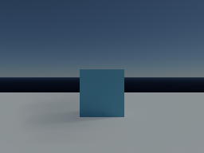
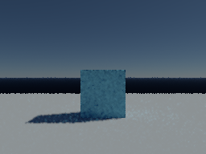
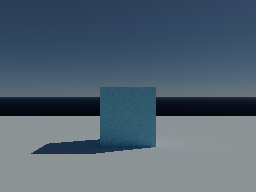

# Continuous sunlight in the sample game

The day/night cycle now advances on the game simulation thread. Rendering captures an immutable lighting state when it starts a new image. The previous 250 ms lighting throttle is removed, and both GPU denoisers can reuse history across gradual sun movement. Enable the existing **Lighting → Day/night cycle** control; the default remains off, with a 600-second full day when enabled.

The clock depends on elapsed active game time, not frame count or rendering speed. A stalled renderer does not stop it. Rendering pause leaves simulation time running; an inactive game suspends it. A slow image finishes with its captured sun position, then the next image captures the current simulation state. This avoids cancelling unfinished work on every simulation tick.

## Performance and cadence

Measurements ran on October 30, 2026, on an RTX 3080 12 GB, driver 616.92, Java 23 and Windows. Other GPU games were closed. Builds and test suites ran separately from timing runs.

`LightingRouteBenchmark` follows a twelve-second elapsed-time combat route with movement, turns, firing and a scoped segment. Each mode has two seconds of warmup and two measured rounds, with reversed order in the second round. It counts fresh images after offscreen 1920×1080 Swing painting, including the game interface. These are rendered images without frame generation; physical input, native swapchain presentation and monitor scanout are excluded.

All modes use NRD RELAX, path roulette, depth 8, one fresh path sample, a pinhole camera, uniform sampling, Full atmosphere quality and bloom off. Automatic resolution changes are disabled. The sun starts at 09:00 and takes 600 seconds to complete a day.

| Configuration | Frozen sun, delivered code | Continuous sun, delivered code |
|---|---:|---:|
| 960×540 image enlarged to 1080p | 123.0–123.7 FPS | 119.9–121.3 FPS |
| 960×540 lighting with native 1080p visibility | 69.5–70.5 FPS | 69.5–72.5 FPS |

These short runs show about a 2% throughput cost in the enlarged-image mode and no consistent penalty in the native-visibility mode. They do not establish a universal overhead bound. The continuous-sun enlarged-image runs have 10.2–10.5 ms p95 fresh-image intervals, so their roughly 120 FPS mean does not establish consistently meeting an 8.33 ms frame budget. [Round summaries](after-route.log), [frame rows, settings and correlated timings](after-route/) retain the evidence.

Before this change, captured sun directions changed 3.9–4.0 times per second, typically about 255 ms apart. Afterward they change on essentially every fresh frame: 119.8–121.2 changes/second in the enlarged-image mode and 69.4–72.3 with native visibility. The simulation itself publishes at its existing approximately 4 ms tick cadence. [Cadence counts](cadence.csv) compare consecutive captured solar vectors, excluding each run's first vector.

The [pre-change runs](before-route.log) measured 107.7–125.8 FPS with the stepped sun at half image resolution, and 68.5–69.9 with native visibility. Their variation is too large to claim a speedup from the new policy. These runs used production code from `f7643f8` plus benchmark-only sun controls and solar-vector logging. Historical figures from other performance reports are not paired baselines for this change.

The separate [fog comparison](fog-route.log) uses the same half-image route with the default local mist enabled. Continuous sunlight delivered 99.5–99.7 FPS, compared with 98.5–101.6 FPS for the frozen sun. The sun-dependent fog transmission table rebuilt for each captured sun direction; its last reported build took about 0.02 ms, compared with one total build for frozen sunlight. The atmosphere table and geometry acceleration structures do not need rebuilding for sun motion alone. The route stays outside the mist region; it measures this configuration's cache overhead and visible transport, not worst-case performance while inside dense fog. [Fog settings and frame timings](fog-route/) preserve both rounds.

## Image quality and remaining limits

`SunMotionBenchmark` renders a stationary box and floor at 256×192 for 96 frames, with simulation timestamps spaced at 60 Hz. It compares an idealized old 4 Hz sun, a continuous sun that clears history every frame, and the delivered continuous-history policy. The stepped case accumulates up to 15 raw samples while holding its lighting state. Continuous cases use one fresh sample at each lighting state. This intentionally compares their different refinement behavior.

Every third frame is compared with a 128-sample reference at the correct current sun position. Image error is mean squared RGB error after the mapping `(x / (1 + x))^(1 / 2.2)`. Temporal residual change is the mean squared change in that error image between adjacent measured frames, 50 ms apart. Lower values are better. The finite-sample reference still contains noise; this metric is a stability proxy, not a human flicker or ghosting assessment.

| Denoiser / full-day duration | Stepped image error | Continuous, reset history | Continuous, retain history |
|---|---:|---:|---:|
| NRD / 600 s | 0.00216218 | 0.00227633 | 0.00199294 |
| NRD / 30 s stress test | 0.00184776 | 0.00197350 | 0.00166258 |
| Built-in / 600 s | 0.00025242 | 0.00052567 | 0.00040494 |
| Built-in / 30 s stress test | 0.00034417 | 0.00058451 | 0.00044270 |

For NRD, retaining history lowers temporal residual change by 11–16% relative to stepped lighting in these sequences. For the built-in filter it lowers residual change relative to resetting every frame, but remains worse than stepped lighting: 0.00060825 versus 0.00028416 at the normal day speed. Continuous lighting therefore trades away some stationary refinement and can show more fine-grained noise with the built-in filter. Removing the lighting jumps does not remove all noise or all causes of flicker.

NRD visibly softens the shadow edge in this scene. The built-in filter retains more edge detail but more noise. Neither result establishes motion readability in the full game or absence of shadow trails. The reference is at the same timestamp in each comparison; the 30-second day deliberately stresses moving shadows.

| NRD continuous history, fast day | Built-in continuous history, fast day | 128-sample reference for NRD's pixel-center primaries |
|---|---|---|
|  |  |  |

Complete errors and selected frames are retained for [NRD normal speed](quality-nrd600/), [NRD fast speed](quality-nrd30/), [built-in normal speed](quality-builtin600/) and [built-in fast speed](quality-builtin30/). Each directory has a matching summary `.log` beside it. The two filters use their existing primary-ray sampling policies, so the separate within-filter comparisons are the controlled comparisons.

## Implementation and verification

`GameSimulation` owns the clock and existing physics executor. `GameRenderer` reads its immutable state without advancing it. `LightingContinuity` tags captured worlds with a simulation timeline, an edit epoch and elapsed active seconds. Manual time edits and cycle start/stop invalidate continuity. Captures serialize these values; older captures default to no continuity.

`GpuLightingHistory` admits changed lighting only within the same timeline and epoch, at most 0.5 seconds apart, with directions within two degrees, bounded color changes, unchanged atmosphere parameters and unchanged fog regions. Existing surface, camera and disocclusion checks still apply. Untagged light edits remain strict. Admitted lighting changes use 0.8 history confidence in the built-in filter and NRD; local clamping and NRD's existing anti-lag handling remain active.

Raw accumulation still resets when captured lighting changes. The GPU random stream includes captured simulation time so a stationary camera receives fresh paths as the sun moves. It excludes process-local timeline identifiers, preserving deterministic replay. This change does not add a rendering-driven simulation clock or interpolate scene properties on the display thread.

The [simulation tests](simulation-final.log) verify equal clock progression at different step rates, immutable snapshots, a blocked renderer, render pause, inactivity and capture compatibility. The [sun history checks](history-check.log) cover both GPU denoisers, gradual/abrupt/stale changes, raw-estimator independence and deterministic replay. The [game suite](game-check.log), [GPU suite](gpu-check.log) and [repository completion gate](verify.log) passed. The style baseline remains at 1976 existing finding groups. Human gameplay assessment remains manual.

## Reproduce

Use the repository root, Java 23 and the optional NRD runtime installed by `./setup-nrd.ps1`. Run verification before measurements, and keep other GPU workloads closed. These benchmarks open no visible game window.

```powershell
./gpu-check.ps1
./game-check.ps1
./verify.ps1
$jdk = "$env:USERPROFILE/.jdks/openjdk-23.0.1/bin"
$cp = 'out/gpu/classes;out/game/classes;out/gpu/lib/*'
& "$jdk/javac.exe" --enable-preview --release 23 -cp $cp -d out/gpu/classes tools/gpu/ReconstructionCheck.java tools/gpu/ReconstructionBenchmark.java tools/gpu/LightingRouteBenchmark.java tools/gpu/SunMotionBenchmark.java
& "$jdk/java.exe" --enable-preview --enable-native-access=ALL-UNNAMED '-Djava.awt.headless=true' -cp $cp game.LightingRouteBenchmark out/sun/replay-route roulette-nrd540,sun-roulette-nrd540,roulette-nrdsplit540,sun-roulette-nrdsplit540
& "$jdk/java.exe" --enable-preview --enable-native-access=ALL-UNNAMED '-Djava.awt.headless=true' -cp $cp game.LightingRouteBenchmark out/sun/replay-fog fog-roulette-nrd540,fog-sun-roulette-nrd540
& "$jdk/java.exe" --enable-preview --enable-native-access=ALL-UNNAMED '-Djava.awt.headless=true' -cp $cp gpu.SunMotionBenchmark out/sun/replay-quality 600
& "$jdk/java.exe" --enable-preview --enable-native-access=ALL-UNNAMED '-Djava.awt.headless=true' -cp $cp gpu.SunMotionBenchmark out/sun/replay-fast 30 builtin
```

For `SunMotionBenchmark`, omit `builtin` to select NRD; use 30 or 600 as the full-day duration. `LightingRouteBenchmark` defaults to 600 seconds; `-Dgame.benchmarkDaySeconds=30` selects its fast-day stress case. [Source hashes](sources.json) identify the delivered implementation and benchmark tools.
