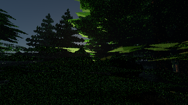
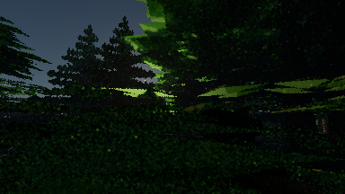
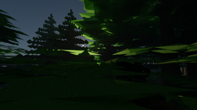

# GPU diffuse reconstruction: first increment

This opt-in sample-game feature adds GPU surface guides, camera/object reprojection, and a small diffuse reconstruction filter. It is the first implementation step for priority 2 in the [120 FPS review](../../game/2026-10-29-performance-review.md). It improves low-sample images at the traced resolution. It does **not** yet reconstruct a 1080p image from a smaller lighting grid, and it does not achieve the 120 real FPS target.

In the GPU sample game, press **Esc** to release the pointer and show settings. Select the **Render** tab, scroll down to **Set up GPU reconstruction**, and click it. The button enables **Temporal reconstruction**, sets aperture to zero, disables **Center detail**, selects **Full** atmosphere/fog resolution, and raises path depth to one if it was zero. It leaves the resolution and frame budget under your control. The feature defaults to off. Changing back to a finite aperture, foveation, reduced atmosphere resolution, or depth zero displays raw output and reports the reason in backend status. Glass and sky pixels stay raw even when the mode is active.

Turning reconstruction off immediately makes leased images expose their raw pixels. Mode changes start a new GPU generation and restart progressive accumulation. Raw values and sample counts for a given transport input and pass count are unchanged by the filter; history weights are presentation metadata, not additional path samples.

Measured on 2026-10-29 with an RTX 3080, Java 23, Vulkan, depth 8, one sample per moving view, uniform sampling, pinhole camera, Full atmosphere, and bloom off:

| Traced grid | Raw GPU work | With reconstruction | Reconstruction pass only | Host call with reconstruction |
|---|---:|---:|---:|---:|
| 1920×1080 | 27.58 ms | 31.00 ms | 2.04 ms | 33.21 ms |
| 960×540 | 6.87 ms | 7.35 ms | 0.46 ms | 8.31 ms |

Each entry is the median of three round medians. Each mode receives 20 warmup frames and 60 measured frames per round; mode order alternates. GPU work includes tracing, guides, reconstruction and packed display encoding. The reconstruction-only column excludes guide generation and publication copies, so it is smaller than the total added cost. The host call also includes preparation, fence waiting and packed readback. Neither timing includes game simulation, Swing/native presentation, input delivery or monitor scanout. The 540p result is therefore **not a claim of 120 FPS at 1080p**. Per-frame data and round summaries are in [1080p.csv](1080p.csv), [1080p.log](1080p.log), [540p.csv](540p.csv) and [540p.log](540p.log).

The original pre-implementation capture settings, including finite aperture and bloom, were also measured: about 28.4 ms at uniform 1080p and 18.5 ms with smooth foveation. [baseline.log](baseline.log) and [baseline.csv](baseline.csv) retain those results. They are context, not a matched comparison with the pinhole/uniform reconstruction measurements above.

A separate 24-view camera route at 384×216 compares one-sample images against 128-sample references for each view:

| Presentation | Mean image error |
|---|---:|
| Raw one-sample image | 0.00188484 |
| Spatial filter, history reset every view | 0.00102401 |
| Spatial filter plus temporal history | 0.00097097 |

The combined filter reduces this error by **48.49%** versus raw. Temporal reuse improves error by **5.18%** beyond the spatial filter alone; most of this scene's improvement comes from spatial filtering. Error is mean squared RGB difference after the approximate display mapping `(max(x,0)/(1+max(x,0)))^(1/2.2)`. It measures agreement with the reference, not temporal stability or aiming accuracy. This is a short camera route through a frozen forest capture, not a combat benchmark. [quality.csv](quality.csv) contains every view; [quality-run.log](quality-run.log) records the settings and result. Its timing rows preceded a host-side metadata-upload optimization; use `1080p.log` for the final full-resolution timings.

| Raw, view 12 | Reconstructed, view 12 | 128-sample reference |
|---|---|---|
|  |  |  |

The [spatial-only image](spatial.png) is available for comparison. These previews use exposure 1 and no bloom.

`assets/gpu/diffuse.comp` captures the existing primary hit's position, normals, surface identity, previous object position, diffuse throughput and primary atmospheric radiance. There are no extra guide rays. `src/gpu/GpuTemporal.java` matches object names, shared geometry and material values, retains previous transforms, and bounds history lifetime to 500 ms. Instance reordering preserves correspondence. New or changed geometry/material gets a new identity; ambiguous duplicate names cannot reuse history.

`assets/gpu/temporal.comp` filters compatible neighboring illumination estimates, reprojects history, validates all four history taps, and clamps history to the current neighborhood. It restores current surface color and atmospheric radiance afterward. Directional foliage uses radiance filtering because its response cannot be separated into a simple color multiplier. Near-black channels, sky and glass retain their raw values. Moving estimates contain at least 20% current contribution; historical weight is capped at eight nominal samples. Refinement reads a frozen prior view so the current progressive mean is not repeatedly counted as independent evidence. Lighting, seed, depth, restart, grid and mode changes invalidate history.

`GpuRenderSession` keeps raw and reconstructed publications in separate leased snapshots. Packed display, resident presentation, exposure conversion and explicit exports use the reconstructed snapshot; raw access retains the original estimator. Histories stay on the GPU. Two guide buffers, two lighting histories and the working presentation buffer consume approximately **475 MiB at 1080p**, or **119 MiB at 540p**, before scene resources and publication snapshots. Total peak device allocation in these runs was 677.4 MiB and 190.9 MiB respectively. Buffer packing and bandwidth remain optimization work.

This is an engine-owned experimental filter, not an NRD or DLSS integration. It can blur fine lighting and lag changing shadows. It has no cross-grid history reuse, temporal upscaling, specular reconstruction, or dedicated treatment of subpixel geometry. Camera-keyed sampling is retained: a stationary camera with animated objects can repeat background noise after each accumulation reset. The measured quality result does not establish performance or ghosting quality during combat. Production denoiser integration still requires its specific signal and motion conventions; see the [official NRD integration requirements](https://github.com/NVIDIA-RTX/NRD#integration).

The proposed next experiment keeps presentation fixed at 1080p and tests lighting at 960×540 and 1280×720. NVIDIA Real-Time Denoisers (NRD) is the first production diffuse-denoising candidate; temporal upscaling is a separate integration decision. Compare each candidate with this filter and full-resolution visibility using the same moving enemies, rifle, scope glass and newly exposed surfaces. Record median and p95 fresh-frame intervals through presentation, total GPU cost and image error against 128-sample references. Inspect repeated lateral movement and fast turns for lost target edges, persistent trails and stale lighting on newly exposed targets. A candidate advances only if it lowers total frame cost without those visible failures; the end target remains 8.33 ms per real presented frame at 1080p, without generated frames.

To reproduce the recorded route, use the existing local capture `out/game/captures/2026-10-29T13-51-40.663364200Z-0c27bbc2-e5b3-472e-b5ac-0ab6028da370`. Capture data is not committed. On another checkout, create a capture with F8 and pass its directory; the results will describe that scene instead. The logs retain the recorded camera and render settings. Run from the repository root:

```powershell
./gpu-build.ps1
$jdk = "$env:USERPROFILE/.jdks/openjdk-23.0.1/bin"
$cp = 'out/gpu/classes;out/game/classes;out/gpu/lib/*'
& "$jdk/javac.exe" --enable-preview --release 23 -cp $cp -d out/gpu/classes tools/gpu/ReconstructionBenchmark.java
$capture = 'out/game/captures/2026-10-29T13-51-40.663364200Z-0c27bbc2-e5b3-472e-b5ac-0ab6028da370'
& "$jdk/java.exe" --enable-preview '-Djava.awt.headless=true' -cp $cp gpu.ReconstructionBenchmark $capture out/reconstruction/replay
& "$jdk/java.exe" --enable-preview '-Djava.awt.headless=true' '-Dgpu.benchmarkCostOnly=true' -cp $cp gpu.ReconstructionBenchmark $capture out/reconstruction/replay-540 960
```

`./gpu-check.ps1` now includes `ReconstructionCheck`. It checks exact raw agreement, progressive means, previous positions for translated/rotated objects despite instance reordering, disocclusion, black channels, lighting changes, glass/sky and unsupported-setting fallback, resize, exposure, resident copies, leases, off/on revisions and shutdown. `GpuUiCheck` exercises the setup button and mode toggle without opening a visible window. [reconstruction-check.log](reconstruction-check.log) and [gpu-check.log](gpu-check.log) record successful runs. The normal `./verify.ps1` and `./game-check.ps1` gates also passed. Interactive pointer capture and combat feel still require human QA. [sources.json](sources.json) identifies the implementation and benchmark sources delivered with this report.
